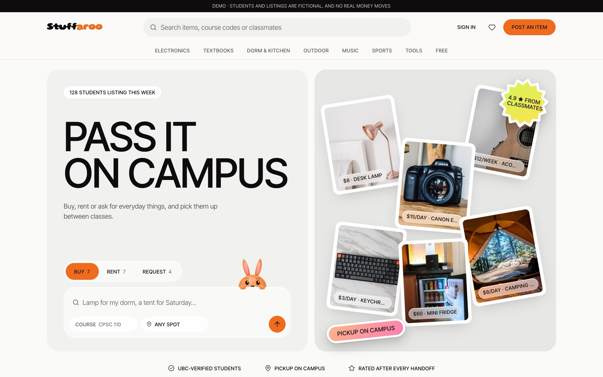
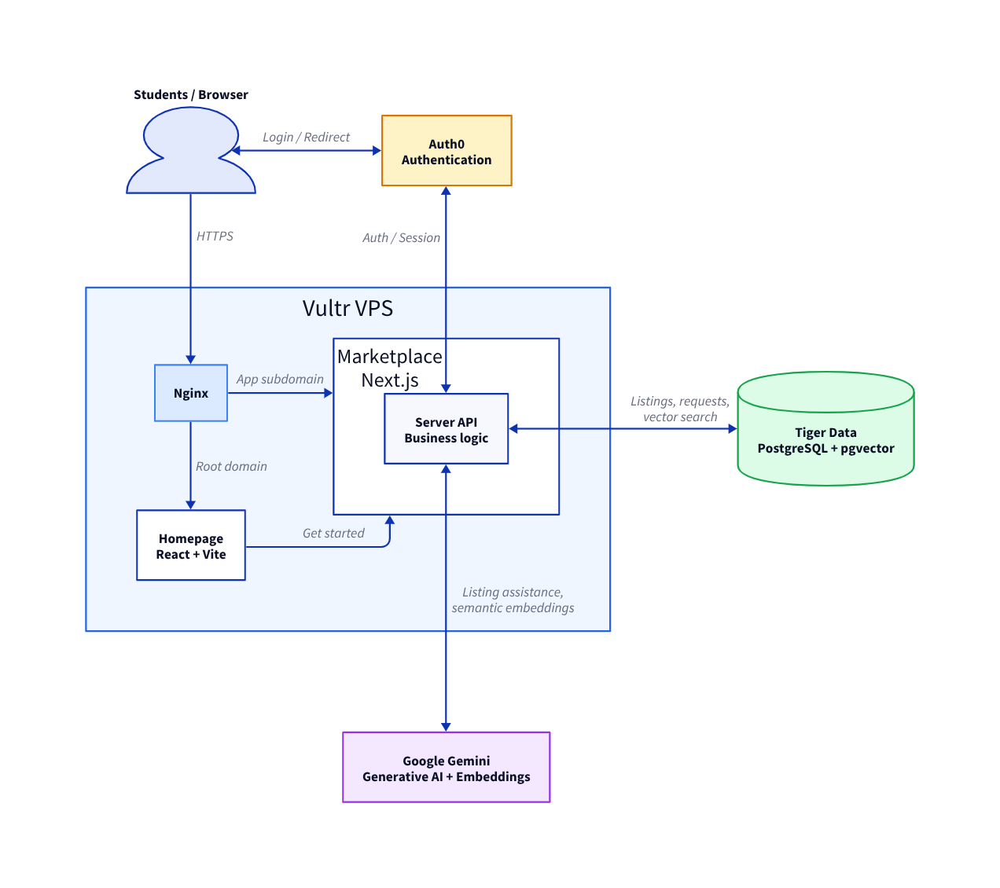
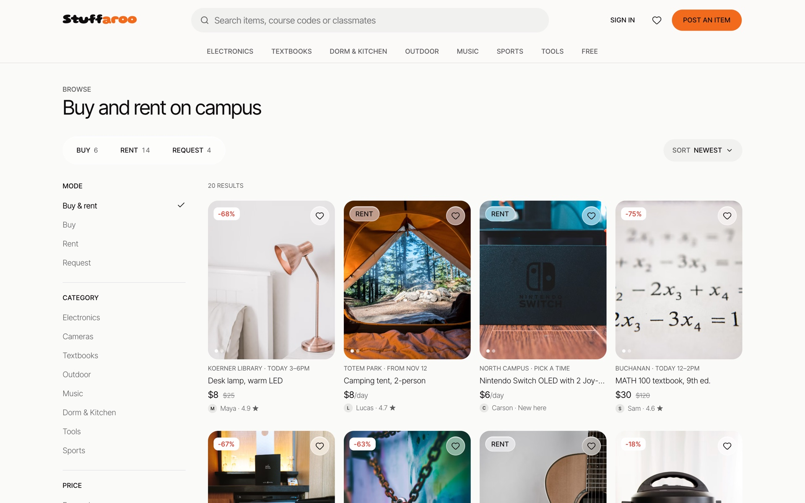
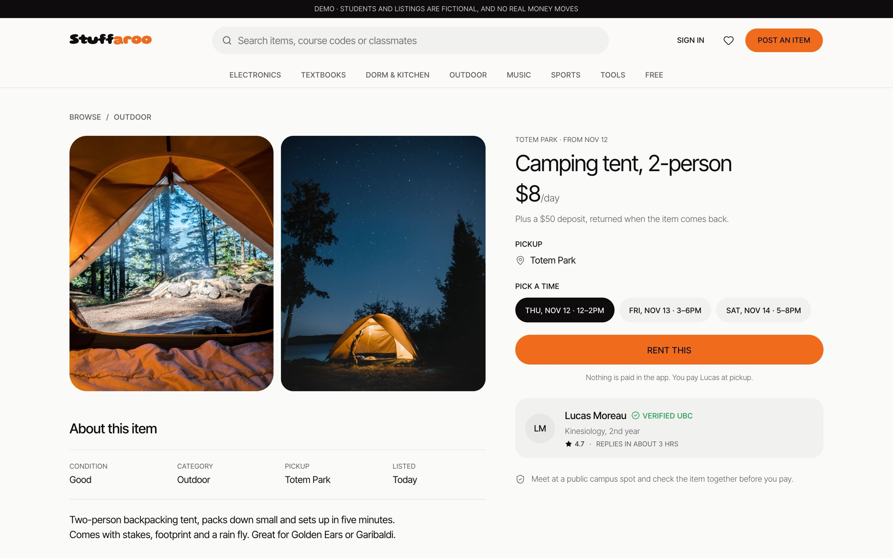
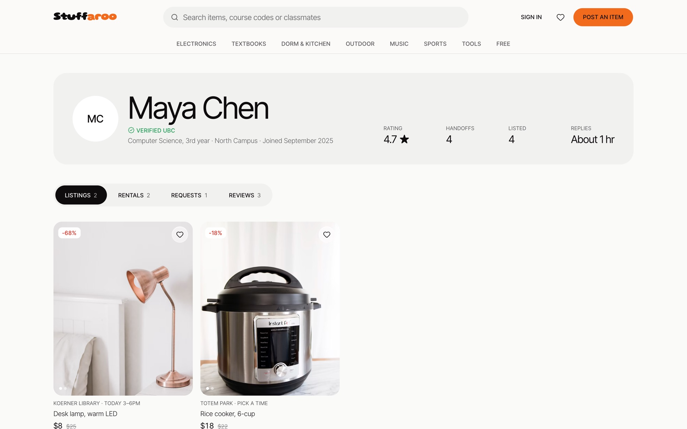
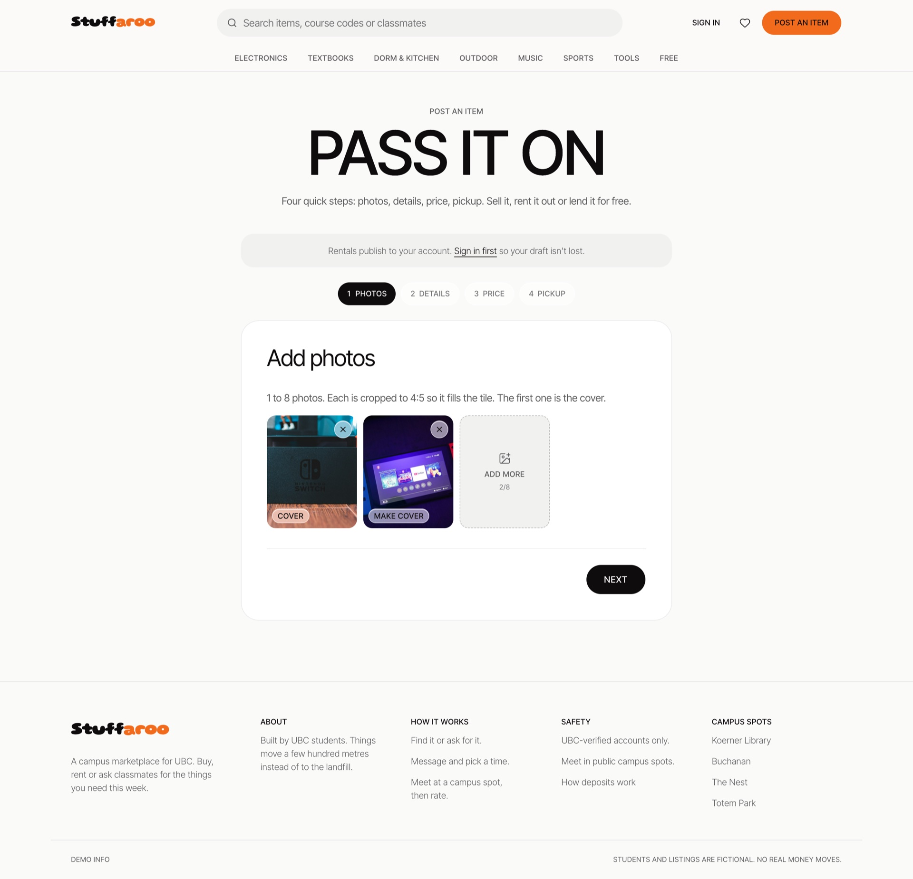
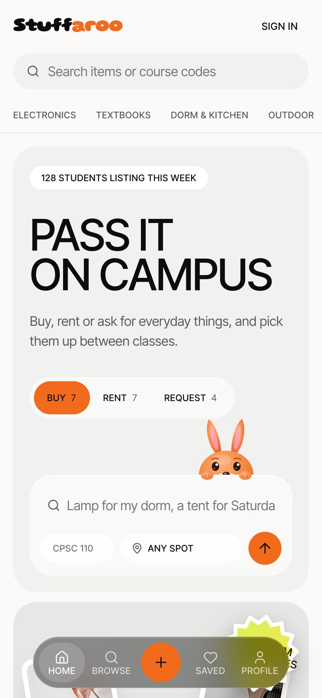
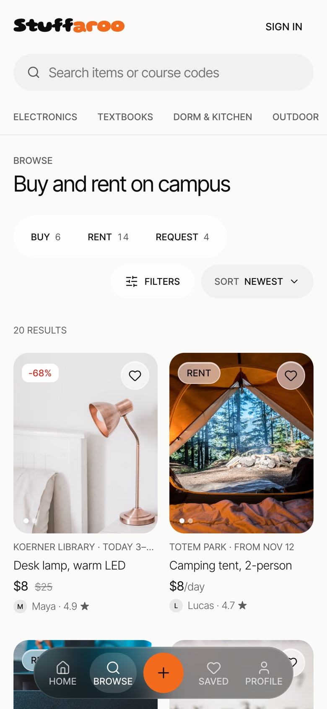
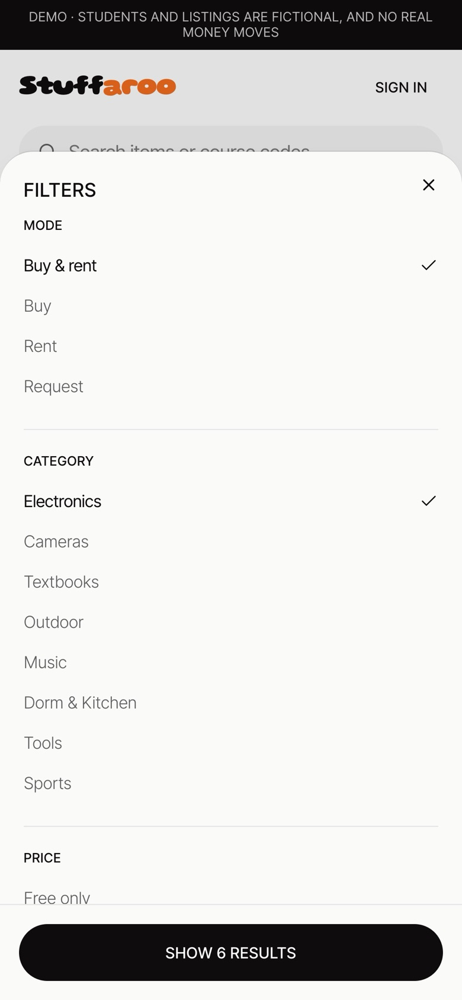
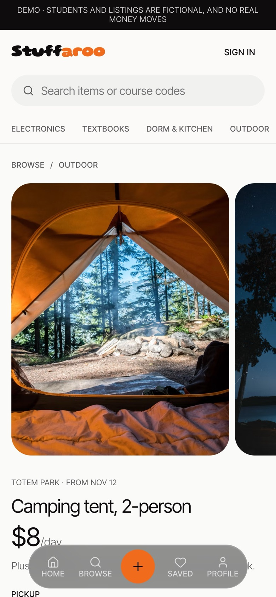

> **Migration in progress:** The target deployment is Vercel + Neon with PostgreSQL full-text search. Follow [the migration and deployment guide](docs/deployment-vercel-neon.md); the Vultr/Tiger descriptions below document the previous deployment. Do not retire it until the new deployment is verified.

<div align="center">

<h1>Stuffaroo</h1>

A campus marketplace where students buy, sell, rent and borrow things from each other. Built for HackCamp 2026.

**Live at [Stuffaroo.shop](https://stuffaroo.shop/marketplace)** · [Demo video](docs/demo/stuffaroo-demo.mp4)

[](https://stuffaroo.shop/marketplace)

</div>

**Tech Stack:**


**CI Status:**

[](https://github.com/carsonjan/Stuffaroo/actions/workflows/ci.yml)
[](https://stuffaroo.shop)

Students buy things they only need for a week, and throw out perfectly good stuff at move-out. Stuffaroo keeps those items on campus: list what you own, post what you need, and let matching connect the two.

## Live demo

- Homepage: https://stuffaroo.shop
- Marketplace: https://stuffaroo.shop/marketplace

Everything runs on one Vultr server and talks to the real services: Tiger Data for the database, Gemini for matching, and Auth0 for sign-in.

## How it works



1. **Nginx** on the Vultr VPS terminates HTTPS for `stuffaroo.shop` (Certbot keeps the certificate renewed) and routes by path: `/marketplace`, `/auth` and `/_next` go to the Next.js marketplace, and everything else goes to the homepage.
2. **The homepage** (React + Vite) is the public landing page. Its "Get started" buttons send students into the marketplace.
3. **Sign-in** goes through **Auth0**. The browser is redirected to Auth0 to log in, and the Next.js server keeps the session and forwards the access token to the API.
4. **The marketplace** (Next.js) renders pages on the server and calls the **FastAPI** business-logic service over the private Docker network. FastAPI verifies the Auth0 token on every write and enforces the rental request lifecycle.
5. **Tiger Data** (Postgres + pgvector + pgvectorscale) stores listings, wanted posts, profiles and requests, along with an embedding for every listing.
6. **Google Gemini** embeds new listings and wanted posts. Matching first applies hard filters in SQL (availability, category, budget, booked dates), then ranks candidates by vector similarity on Tiger's DiskANN index, and finally asks Gemini to drop any that don't fit.

All five containers (Nginx, Certbot, homepage, marketplace and API) are defined in [`compose.yaml`](compose.yaml). Only ports 80 and 443 are public.

## Screenshots

| Browse | Listing detail |
| --- | --- |
| [](docs/snapshots/desktop/03-browse.jpg) | [](docs/snapshots/desktop/06-listing-detail.jpg) |
| **Student profile** | **Post an item** |
| [](docs/snapshots/desktop/08-profile.jpg) | [](docs/snapshots/desktop/10-post-photos.jpg) |

<p>
  
  
  
  
</p>

More screenshots are in [`docs/snapshots`](docs/snapshots).

## Status

The rent and borrow journey runs end to end on the real API and database: browsing, listings, profiles, wanted posts, AI matching, creating listings and wanted posts, rental requests and the dashboard. Sign-in goes through Auth0 (see [docs/handoff-auth0.md](docs/handoff-auth0.md)). The buy/deals/move-out sections, AI listing drafts and the Solana deposit demo still use sample or simulated data, and are labelled that way. Remaining work is in [docs/todo.md](docs/todo.md).

| Area | State |
| --- | --- |
| Landing page (`apps/homepage`) | Marketing homepage built with Lovable (TanStack Start). Its buttons link to the marketplace |
| Web app (`apps/web`) | All main screens built and responsive. Rent/borrow screens read and write through the API; buy, deals and move-out sections use `src/lib/mock-shop.ts` |
| API (`apps/api`) | FastAPI: listings, profiles, wanted posts, matching, `/api/me`, and rental requests with a server-enforced lifecycle. See [docs/api-contract.md](docs/api-contract.md) |
| Database | Tiger Cloud Postgres (pgvector + pgvectorscale), live behind the deployed API. Locally, the same image in Docker. Schema in `apps/api/migrations/`, fictional demo data in `apps/api/app/seed/` |
| Auth | Auth0 in Next.js; FastAPI verifies the forwarded access token. Configured on the deployed site; locally it stays off until the Auth0 env vars are set |
| AI matching | Real, and live on Vertex AI: hard filters in SQL (availability, category, budget, booked dates, own listings), then Gemini embeddings ranked on Tiger's DiskANN index, then a Gemini relevance check that can only remove candidates. Without Gemini configured it falls back to keyword ranking and the UI says so |
| AI listing drafts | Canned sample response, labelled as a mockup |
| Solana deposit | Uses your real accepted request and its deposit amount, but the transfer itself is simulated and labelled as such. No wallet is contacted |
| Deployment | Docker Compose on a Vultr VPS behind Nginx and Certbot, live at https://stuffaroo.shop (see [Deploying to Vultr](#deploying-to-vultr)) |

Creating things and changing request status needs sign-in. Where Auth0 is not configured (a fresh local checkout), those screens explain that instead of pretending to work.

## Features

- **Landing page** (`apps/homepage`, `/`): the public homepage, with links into the marketplace.
- **Marketplace home** (`/marketplace`): value proposition, featured listings, categories, deals and move-out highlights.
- **Browse** (`/marketplace/browse`): browse listings, search by name, filter by category and price.
- **Listing detail** (`/marketplace/listings/[id]`): item info, owner, availability and a borrow/rent request form.
- **Create listing** (`/marketplace/listings/new`): listing form that saves to the API and embeds the new listing for matching. Its "Draft with AI" helper is still a labelled mockup.
- **Wanted posts** (`/marketplace/wanted`, `/marketplace/wanted/new`, `/marketplace/wanted/[id]`): describe what you need in your own words and see matching listings with a reason for each match. Results say whether they were ranked with Gemini or by the keyword fallback.
- **Deals and move-out** (`/marketplace/deals`, `/marketplace/move-out`): price drops, bundles and a countdown to move-out day (sample data).
- **Dashboard** (`/marketplace/dashboard`, `/marketplace/dashboard/requests`): your listings and incoming and outgoing rental requests, with accept, reject, cancel, "mark handed over" and "mark returned" actions.
- **Profiles** (`/marketplace/profile/[id]`): public student profile with their listings.
- **Deposit demo** (`/marketplace/deposits`): walkthrough of a Solana Devnet deposit for an accepted request. The transfer is simulated.

## Tech stack

- **Landing page:** TanStack Start (React + Vite), Tailwind CSS, generated with Lovable
- **Web:** Next.js 16 (App Router), React 19, TypeScript (strict), Tailwind CSS 4, shadcn/ui components on Base UI, Lucide icons
- **API:** Python 3.12, FastAPI, Pydantic, psycopg, uv, pytest
- **Data and AI:** Tiger Cloud Postgres with pgvector and pgvectorscale (DiskANN); Gemini embeddings (`gemini-embedding-001`) and a Gemini relevance check on Vertex AI, via `google-genai`
- **Auth:** Auth0 (`@auth0/nextjs-auth0` v4), with RS256 tokens verified in FastAPI
- **Hosting:** Vultr VPS running Docker Compose, with Nginx and Certbot (Let's Encrypt) in front
- **Tooling:** pnpm workspaces, Biome (TS/CSS/JSON), Ruff (Python), Lefthook pre-commit hooks

The visual design system (colours, type, spacing tokens) is documented in [apps/web/DESIGN.md](apps/web/DESIGN.md).

## Repository layout

```text
apps/
  homepage/       landing page (TanStack Start, generated with Lovable)
  web/            Next.js frontend
    src/app/          routes
    src/components/   UI, grouped by domain (marketplace, listings, wanted, requests, ...)
    src/lib/          API client, auth, categories, formatting, buy/deals sample data
  api/            FastAPI backend
    app/              main.py, routers/, services/, models/, core/, seed/
    migrations/       SQL schema
    tests/
docs/
  api-contract.md       API endpoints and rules
  todo.md               remaining work
  setup-services.md     switching on Tiger Cloud, Gemini and Auth0
  handoff-auth0.md      Auth0 setup and demo accounts
  sponsor-evidence.md   what each sponsor technology powers, and what's verified
```

## Setup

Install Node.js 24, pnpm 12.18.0, and uv with Python 3.12 or newer. From the repository root:

```sh
pnpm install
uv sync --directory apps/api
pnpm exec lefthook install
```

The workspace approves the `lefthook` installation script in `pnpm-workspace.yaml`; `sharp` and `unrs-resolver` remain denied as in the original web setup. Review other packages individually if pnpm requests approval.

### Database

The API uses PostgreSQL with pgvector and btree_gist. `pnpm db:up` starts a compatible local pgvector image.

```sh
pnpm db:up        # start timescale/timescaledb-ha:pg17 on localhost:5433
pnpm db:migrate   # apply apps/api/migrations/*.sql
pnpm db:seed      # load the fictional demo students, listings and requests
pnpm db:embed     # embed listings with Gemini (needs Gemini set up in apps/api/.env)
```

To use Tiger Cloud instead, copy `apps/api/.env.example` to `apps/api/.env` and set `DATABASE_URL` to the service URL (with `sslmode=require`), then run `pnpm db:migrate` and `pnpm db:seed`.

The web app reads `API_URL` (default `http://localhost:8000`). For sign-in, copy `apps/web/.env.example` to `apps/web/.env.local` and follow [docs/handoff-auth0.md](docs/handoff-auth0.md).

### Gemini (matching)

Embeddings run through **Vertex AI on the `stuffaroo` Google Cloud project**, billed to its credits. Use one of these:

**Your own Google login** (teammates added to the project in IAM with the *Agent Platform User* and *Service Usage Consumer* roles):

1. Install the gcloud CLI. On macOS:

   ```sh
   brew install --cask gcloud-cli
   ```

   On Linux or Windows, follow https://cloud.google.com/sdk/docs/install. Open a new terminal afterwards and check it with `gcloud --version`.

2. Sign in once, and bill your usage to the project:

   ```sh
   gcloud auth application-default login
   gcloud auth application-default set-quota-project stuffaroo
   ```

3. In `apps/api/.env`, set `GOOGLE_GENAI_USE_VERTEXAI=true` and `GOOGLE_CLOUD_PROJECT=stuffaroo`, and leave `GOOGLE_APPLICATION_CREDENTIALS` empty (`GOOGLE_CLOUD_LOCATION` defaults to `us-central1`).

**Or the service-account key:** put `gcp-key.json` (shared privately, never through git) in `apps/api/` and set `GOOGLE_APPLICATION_CREDENTIALS=gcp-key.json` in `apps/api/.env`. No gcloud needed. This is also what the Docker route uses.

Run `pnpm check:setup` to confirm, and `pnpm db:embed` if any listing has no embedding. A Google AI Studio key in `GEMINI_API_KEY` works instead. Without any of these, matching uses the labelled keyword fallback.

API tests create a throwaway `stuffaroo_test` database on the local server and skip if it isn't running. CI runs them against the same image.

## Running

With `apps/api/.env` (and `apps/web/.env.local` for sign-in) in place, from the repository root:

```sh
pnpm check:setup  # confirm the database, Gemini and Auth0 are connected
pnpm dev          # web on http://localhost:3000 and API on http://localhost:8000
```

Then open http://localhost:3000/marketplace (the root `/` of the Next.js app is still the starter page; the landing page is the separate `apps/homepage` app).

To run the landing page and the marketplace together:

```sh
./run.sh          # pnpm dev plus the homepage dev server
```

For local development, `run.sh` points the homepage buttons at `http://localhost:3000/marketplace`.

```sh
pnpm dev:web      # web only
pnpm dev:api      # API only
pnpm api:docker   # API in Docker instead of uv; run `pnpm dev:web` alongside it
```

The API health endpoint is at `http://localhost:8000/health`.

## Deploying to Vultr

Docker Compose runs Nginx, Certbot, the homepage, the marketplace, and the API. Nginx publishes ports 80 and 443; the application ports are private to the Docker network. Certbot obtains and renews the certificate automatically, and Nginx switches to HTTPS when it is available.

1. Point an A record for `stuffaroo.shop` at the Vultr server's public IPv4 address. Open ports 80 and 443 in the Vultr and server firewalls. Install Docker with Compose. The marketplace build also needs access to Google Fonts.
2. On the server, copy `apps/api/.env.example` to `apps/api/.env` and `apps/web/.env.example` to `apps/web/.env.local`, then fill in the production values. Set `DATABASE_URL` to a reachable PostgreSQL instance with the required extensions; the example's local database default will not work inside the API container. For Gemini, use `GEMINI_API_KEY` and disable Vertex AI, or configure credentials available inside the container. Do not copy secrets into the repository or image.
3. Configure Auth0 with `https://stuffaroo.shop/auth/callback` as an allowed callback URL, `https://stuffaroo.shop` as an allowed logout URL and web origin, and the matching API audience. Compose sets `APP_BASE_URL` and the internal `API_URL` for the web container.
4. Build and start everything:

   ```sh
   docker compose up -d --build
   ```

   Nginx is rebuilt when you run `docker compose up`, so changes to `nginx/` are picked up automatically. After DNS resolves, certificate issuance may take a few minutes. Until then the site is available over HTTP; sign-in requires HTTPS. Check `docker compose logs certbot nginx` if issuance fails. Certificates persist in the `certificates` Docker volume; do not delete it when restarting the stack.
5. For a new database, apply the migrations once:

   ```sh
   docker compose run --rm api python -m app.core.db
   ```

   Seed data separately only if required for the target database; see the database setup above. Visit `https://stuffaroo.shop/` and `https://stuffaroo.shop/marketplace`, then check sign-in and the marketplace's API-backed pages. Inspect failures with `docker compose logs`.

### Connecting the real services

To switch on Tiger Cloud, Gemini and Auth0, follow [docs/setup-services.md](docs/setup-services.md). `pnpm check:setup` reports what is connected and how to fix anything that isn't. Teammates can run the API in Docker with `pnpm api:docker` (see the guide's "For teammates" section).

## Checks

```sh
pnpm check        # lint, type check and tests
```

`pnpm typecheck` runs `next typegen` first, so the route types (`PageProps`, `LayoutProps`) exist on a fresh checkout.

GitHub Actions (`.github/workflows/ci.yml`) runs `pnpm check` and a production build of the web app on every pull request and on pushes to `main`.

## Demo

Use the live site at https://stuffaroo.shop/marketplace, or run it locally with the database seeded. With two demo Auth0 users (see [docs/handoff-auth0.md](docs/handoff-auth0.md)), for example Maya and Jordan:

1. As Jordan, list an item at `/marketplace/listings/new`.
2. As Maya, describe a need at `/marketplace/wanted/new` and click "Find matches". The results say whether they were ranked with Gemini embeddings or by keyword.
3. Open a matching listing and send a request.
4. As Jordan, accept it at `/marketplace/dashboard/requests`, then mark it handed over and returned.
5. Optionally walk through the simulated Devnet deposit at `/marketplace/deposits`.

Listings, people and requests come from the seeded fictional demo data plus whatever you create. The deposit step is simulated and labelled as such.

## Team

Built at HackCamp 2026 by Carson Jan, Yilei Zhou, Wyn S.
